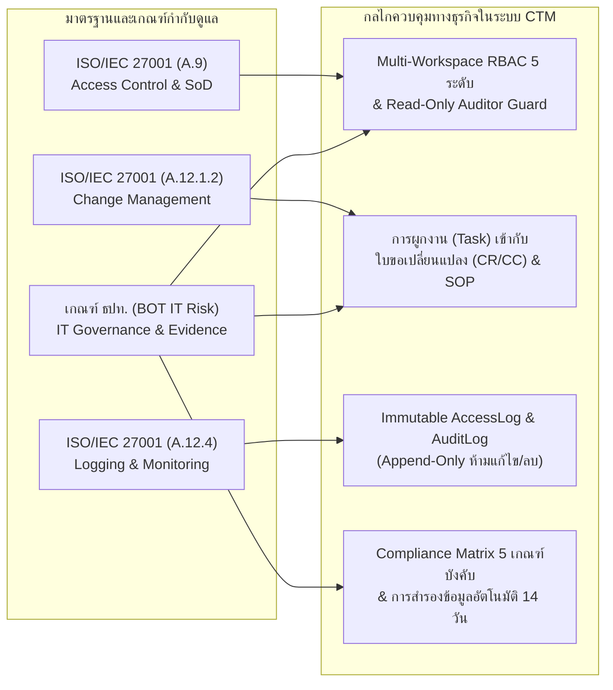

# เอกสารความต้องการทางธุรกิจฉบับสมบูรณ์ (Business Requirements Document - BRD)

**ชื่อโครงการ:** ระบบศูนย์กลางการบริหารจัดการทีมคลาวด์และธรรมาภิบาลไอที (Cloud Team Management - CTM)  
**รหัสเอกสาร:** CTM-BRD-FINAL-v1.0  
**สถานะเอกสาร:** 🟢 อนุมัติใช้งาน (Approved & Baselined — Gate A)  
**วันที่อนุมัติ:** 11 กันยายน 2026 (อัปเดตล่าสุด: 23 ตุลาคม 2026)  
**อ้างอิงเอกสารก่อนหน้า:** [`DRAFT_BRD.md`](./DRAFT_BRD.md)  

---

## 1. บทสรุปสำหรับผู้บริหาร (Executive Summary)

**Cloud Team Management (CTM)** คือแพลตฟอร์มบริหารจัดการงานและกำกับดูแลระบบคลาวด์แบบครบวงจรที่ติดตั้งภายในโครงสร้างพื้นฐานขององค์กร (Self-Hosted Container Stack) พัฒนาขึ้นเพื่อยกระดับประสิทธิภาพการทำงานของทีมวิศวกรคลาวด์ (Cloud, SRE, DevSecOps และ Platform Engineering) ควบคู่ไปกับการสร้างความโปร่งใสและพร้อมรับการตรวจสอบ (Audit Readiness) ตามมาตรฐานสากล **ISO/IEC 27001** และหลักเกณฑ์การกำกับดูแลความเสี่ยงด้านเทคโนโลยีสารสนเทศของ **ธนาคารแห่งประเทศไทย (Bank of Thailand - BOT IT Governance)**

เอกสารฉบับนี้ได้รวบรวมมติจากการทบทวนฉบับร่าง ([`DRAFT_BRD.md`](./DRAFT_BRD.md)) และกำหนดเป็นข้อกำหนดทางธุรกิจ กฎเกณฑ์ด้านการกำกับดูแล และตัวชี้วัดความสำเร็จของโครงการอย่างเป็นทางการ

---

## 2. วัตถุประสงค์ทางธุรกิจและตัวชี้วัดความสำเร็จ (Business Objectives & KPIs)

| รหัส | วัตถุประสงค์ทางธุรกิจ (Strategic Objective) | ตัวชี้วัดความสำเร็จ (Key Performance Indicators - KPIs) | เป้าหมาย (Target) |
|---|---|---|---|
| **BO-01** | **รวมศูนย์การบริหารโครงการและงานวิศวกรรมคลาวด์** | สัดส่วนโครงการและงานของทีมคลาวด์ที่ถูกติดตามผ่านระบบ CTM และแผนผัง Gantt | **100%** ของโครงการในสายงาน |
| **BO-02** | **ยกระดับความพร้อมรับการตรวจประเมิน (Audit Readiness)** | ระยะเวลาที่ใช้ในการรวบรวมเอกสารหลักฐานโครงการและประวัติการอนุมัติเปลี่ยนแปลง (CR/CC) เมื่อผู้ตรวจสอบเรียกดู | ลดลง **≥ 80%** (ตรวจสอบได้ทันทีผ่านหน้าจอ) |
| **BO-03** | **บังคับใช้หลักการแบ่งแยกหน้าที่ (Segregation of Duties)** | จำนวนเหตุการณ์ที่ผู้ตรวจสอบ (`auditor`) หรือผู้สังเกตการณ์ (`viewer`) สามารถแก้ไขหรือลบข้อมูลในระบบได้ | **0 ครั้ง** (Zero Unauthorized Mutation) |
| **BO-04** | **รักษาอธิปไตยและความคงทนของข้อมูล (Data Sovereignty)** | สัดส่วนไฟล์หลักฐานและข้อมูลธุรกิจที่จัดเก็บในเครื่องเซิร์ฟเวอร์องค์กรพร้อมระบบสำรองข้อมูลรายวัน | **100%** (RPO ≤ 24 ชม., เก็บย้อนหลัง 14 วัน) |
| **BO-05** | **เพิ่มผลิตภาพของวิศวกรด้วย Agentic AI Copilot** | ลดเวลาในการร่างเอกสารคู่มือปฏิบัติงาน (Runbook), การแปลงแผนงานเป็น Task, และการจัดทำรายงานผู้บริหาร | ลดเวลาทำงานเอกสารลง **≥ 50%** |

---

## 3. ผู้มีส่วนได้ส่วนเสียและตารางความรับผิดชอบ (Stakeholders & RACI Matrix)

กำหนดบทบาทตามหลักการ **RACI** (*R = Responsible, A = Accountable, C = Consulted, I = Informed*):

| กิจกรรม / กระบวนการทางธุรกิจ | ผู้บริหารระบบ (Admin) | หัวหน้าทีม (Lead) | วิศวกร (Member) | ผู้ตรวจสอบ (Auditor) | ผู้สังเกตการณ์ (Viewer) |
|---|:---:|:---:|:---:|:---:|:---:|
| การตั้งค่าระบบ สร้างผู้ใช้ และจัดการสิทธิ์ระดับแพลตฟอร์ม | **A / R** | I | I | I | I |
| การสร้างและตั้งค่าพื้นที่ทำงาน (Workspace) | **A / R** | **R** | I | I | I |
| การวางแผนโครงการ แผนผัง Gantt และการมอบหมายงาน | C | **A / R** | **R** | I | I |
| การเขียนคู่มือปฏิบัติงาน (Knowledge / SOP) และใช้ AI Copilot | C | **A** | **R** | I | I |
| การอัปโหลดเอกสารหลักฐานโครงการ (CRA, Diagram, RBAC, CR/CC) | C | **A** | **R** | C | I |
| การตรวจสอบความสอดคล้อง (Compliance Matrix) และตรวจ Audit/Access Logs | C | I | I | **A / R** | I |
| การติดตามภาพรวมโครงการและรายงานความก้าวหน้า | I | **R** | I | I | **A / I** |

---

## 4. ความสอดคล้องตามมาตรฐานสากลและข้อกำหนดกฎหมาย (Regulatory & Compliance Alignment)

ระบบ CTM ถูกออกแบบให้ตอบสนองต่อข้อกำหนดด้านการกำกับดูแลเทคโนโลยีสารสนเทศโดยตรง ดังนี้:

---

## 5. ความต้องการทางธุรกิจที่ได้รับอนุมัติ (Approved Business Requirements)

| รหัสความต้องการ | รายละเอียดความต้องการทางธุรกิจ (Business Requirement Description) | ลำดับความสำคัญ |
|---|---|:---:|
| **BR-01: การแบ่งแยกพื้นที่ทำงาน (Multi-Workspace Tenancy)** | ระบบต้องสามารถแยกพื้นที่ทำงานตามสายงานหรือหน่วยงาน (เช่น Engineering, Infrastructure, Security, Governance, QA, Operations) เพื่อให้การบริหารโครงการ เอกสาร และรายชื่อสมาชิกมีความเป็นสัดส่วน | **Must Have** |
| **BR-02: การควบคุมสิทธิ์และการแบ่งแยกหน้าที่ (RBAC & SoD)** | ระบบต้องรองรับสิทธิ์ระดับแพลตฟอร์ม (`admin`, `member`, `auditor`) และระดับ Workspace (`admin`, `lead`, `member`, `auditor`, `viewer`) โดยบทบาท `auditor` และ `viewer` ต้องถูกจำกัดให้อ่านข้อมูลได้เท่านั้นในทุกกรณี | **Must Have** |
| **BR-03: การบริหารโครงการและตารางเวลา (Project & Gantt Management)** | ระบบต้องแสดงสถานะโครงการ ความคืบหน้า ปีงบประมาณ และมีแผนผังแกนต์ (Interactive Gantt Chart) ที่ปรับแต่งช่วงเวลาและระยะทางของงานแต่ละเฟสได้แบบ Real-time | **Must Have** |
| **BR-04: ความเชื่อมโยงของการเปลี่ยนแปลง (Change & SOP Traceability)** | งาน (Task) ที่เกี่ยวข้องกับการปรับปรุงระบบต้องสามารถอ้างอิงไปยังคู่มือขั้นตอนปฏิบัติงาน (Task SOP) และเอกสารอนุมัติการเปลี่ยนแปลง (CR/CC Document) เพื่อใช้เป็นหลักฐานตรวจสอบย้อนหลังได้ | **Must Have** |
| **BR-05: ศูนย์ตรวจสอบความสอดคล้อง (Compliance Matrix & Evidence)** | ระบบต้องมีตารางประเมินความพร้อมของทุกโครงการเทียบกับเอกสารบังคับ 5 หมวดหมู่ ได้แก่ `CRA`, `Diagram`, `RBAC`, `CR/CC`, และ `TestEvidence` พร้อมคำนวณคะแนนความพร้อม (%) อัตโนมัติ | **Must Have** |
| **BR-06: การจัดการคลังความรู้และเครื่องมือโต้ตอบ (Knowledge Hub)** | ระบบต้องรองรับการจัดเก็บคู่มือทั้งรูปแบบ Markdown และ Interactive HTML ที่รันในสภาพแวดล้อมปลอดภัย (Sandboxed) พร้อมระบบจัดหมวดหมู่และการค้นหาข้อความแบบทันที | **Must Have** |
| **BR-07: ผู้ช่วยอัจฉริยะ AI Copilot (Enterprise AI Productivity)** | ระบบต้องมีผู้ช่วย AI (Gemini 3.8 Flash) ที่เข้าใจบริบททั้งหมดของ Workspace รองรับการอ่านไฟล์แนบหลากหลายตระกูล (PDF, Word, Excel, PowerPoint, Outlook) ช่วยสกัดรายการงานเป็นกลุ่ม (Batch Tasks) ช่วยเขียนบทความ และสรุปรายงานผู้บริหารได้ | **Must Have** |
| **BR-08: การคำนวณภาระงานจริงของสมาชิก (Dynamic Team Workload)** | ระบบต้องคำนวณสัดส่วนภาระงาน (%) ของสมาชิกแต่ละคนโดยอัตโนมัติจากจำนวนงานที่ยังดำเนินการไม่เสร็จ เพื่อให้หัวหน้าทีมจัดสรรทรัพยากรบุคคลได้อย่างสมดุล | **Must Have** |
| **BR-09: บันทึกประวัติที่เปลี่ยนแปลงไม่ได้ (Immutable Audit & Access Logs)** | ระบบต้องบันทึกเหตุการณ์เข้าสู่ระบบทั้งหมด (`AccessLog`) และการเปลี่ยนแปลงข้อมูลทางธุรกิจทั้งหมดพร้อมค่าก่อน-หลัง (`AuditLog`) โดยไม่อนุญาตให้แก้ไขหรือลบบันทึกใดๆ และส่งออกเป็นไฟล์ CSV ได้ | **Must Have** |
| **BR-10: ความต่อเนื่องทางธุรกิจและการสำรองข้อมูล (BCP & Local Storage)** | ไฟล์แนบทั้งหมดต้องถูกเก็บไว้บนพื้นที่จัดเก็บของเซิร์ฟเวอร์องค์กรโดยตรง และต้องมีกระบวนการสำรองฐานข้อมูลพร้อมไฟล์แนบอัตโนมัติทุกคืน | **Must Have** |

---

## 6. กฎเกณฑ์ทางธุรกิจและธรรมาภิบาล (Business Rules & Governance Policies)

จากการหาข้อสรุปในระยะ Draft โครงการได้กำหนดกฎเหล็กทางธุรกิจ (Business Rules) ที่ระบบต้องบังคับใช้ดังนี้:

1. **กฎการห้ามลบผู้ใช้งาน (Deactivate-Never-Delete Policy — อ้างอิง ADR-0001):**
   - เมื่อพนักงานลาออกหรือเปลี่ยนสายงาน ห้ามลบข้อมูลผู้ใช้ออกจากฐานข้อมูลเด็ดขาด ให้ใช้การปิดสถานะ (`isActive = false`) เพื่อตัดสิทธิ์การล็อกอินทันที แต่ยังคงรักษาชื่อและประวัติความเป็นเจ้าของงาน (`ownerId`) และผู้อัปโหลดเอกสารในอดีตไว้ครบถ้วน
2. **กฎการปกป้องผู้ดูแลระบบคนสุดท้าย (Last Active Admin Guard):**
   - ระบบต้องไม่อนุญาตให้ผู้ดูแลระบบคนสุดท้ายที่ยังเปิดใช้งานอยู่ทำการปิดสถานะตนเอง หรือลดระดับสิทธิ์ของตนเอง เพื่อป้องกันภาวะระบบไร้ผู้ดูแล (System Lockout)
3. **กฎการปกป้องพื้นที่ทำงานหลัก (Default Workspace Guard):**
   - ห้ามลบพื้นที่ทำงานเริ่มต้นของระบบ (`default-workspace-engineering`) เพื่อรับประกันความต่อเนื่องของข้อมูลพื้นฐาน
4. **กฎสิทธิ์การลบเอกสารหลักฐาน (Document Deletion Governance — อ้างอิง ADR-0005):**
   - เอกสารหลักฐานโครงการ (`ProjectDocument`) สามารถลบได้เฉพาะ **"ผู้อัปโหลดเอกสารชิ้นนั้น"** หรือ **"ผู้ดูแลระบบ (`admin`)"** เท่านั้น สมาชิกคนอื่นและผู้ตรวจสอบ (`auditor`) ไม่มีสิทธิ์ลบ
5. **กฎความเป็นส่วนตัวของข้อมูลเมื่อเชื่อมต่อ AI (AI Snapshot Privacy Rule):**
   - ข้อมูลที่ส่งเข้าสู่บริบทของ AI Copilot ต้องไม่มีการส่งค่ารหัสผ่าน (`passwordHash`) หรืออีเมลส่วนตัวของผู้ใช้งานออกไปภายนอกโดยเด็ดขาด
6. **กฎการรวมศูนย์ข้อมูลตั้งค่าระบบผ่าน `.env` (Single Source of Configuration via `.env`):**
   - พารามิเตอร์ด้านสภาพแวดล้อมทั้งหมด (เช่น โดเมน `DOMAIN`, พอร์ต `PORT`, ข้อมูลเชื่อมต่อฐานข้อมูล `POSTGRES_*`, ความลับเซสชัน `SESSION_SECRET`, บัญชีผู้ดูแลเริ่มต้น `ADMIN_EMAIL`/`ADMIN_PASSWORD`, ขีดจำกัดไฟล์แนบ `MAX_ATTACHMENT_BYTES`, และค่าโมเดล `GEMINI_MODEL` / `GEMINI_API_KEY`) ต้องถูกดึงมาจากไฟล์ [`.env`](../.env) ผ่านตัวโหลดค่ากำหนดกลาง ([`api/src/config.ts`](../api/src/config.ts)) และห้ามบันทึกไฟล์ `.env` ที่มีคีย์ความลับจริงขึ้นสู่คลังโค้ดสาธารณะ (ใช้ [`.env.example`](../.env.example) เป็นแม่แบบ)

---

## 7. ขอบเขตโครงการและแผนงานระยะถัดไป (Project Scope & Phased Roadmap)

### 7.1 ขอบเขตที่ดำเนินการเสร็จสมบูรณ์ในระยะปัจจุบัน (Delivered Scope — Release 1.0)
- โครงสร้างพื้นฐาน Self-Hosted Docker Compose (Caddy 2 HTTPS, Express 5 API, React 19 SPA, PostgreSQL 17, Nightly Backup)
- ระบบจัดการผู้ใช้, โปรไฟล์ส่วนตัว, Multi-Workspace Switcher และ RBAC 5 ระดับ
- ระบบบริหารโครงการ, Interactive Gantt Chart, Task Drawer, และการคำนวณ Dynamic Workload
- ระบบ Compliance Matrix, Project Documents Governance, และการผูก Task เข้ากับ SOP / ใบ CR-CC
- ระบบ Knowledge Hub (Markdown + TOC Scrollspy + Sandboxed Interactive HTML + Document Importer)
- ระบบ Agentic AI Copilot (Gemini 3.8 Flash, 1M Char Snapshot, Office/Outlook File Parser, Batch Task Proposals, Executive Report, In-Editor Co-Author)
- ระบบ Immutable Access Logs & Audit Logs พร้อมตัวกรองและปุ่ม Export CSV

### 7.2 แผนงานระยะถัดไป (Future Roadmap — Release 2.0)
- **Automated Multi-Cloud Asset Discovery:** เชื่อมต่อ API แบบ Read-only กับ AWS, Google Cloud, และ Microsoft Azure เพื่อดึงรายการทรัพยากรคลาวด์อัตโนมัติ (ปัจจุบันในหน้าจอ `Cloud resources` แสดงเป็น Roadmap Preview และมีโครงสร้างข้อมูลรองรับไว้แล้ว)
- **FinOps Anomaly Detection & BOT Tagging Validation:** ระบบแจ้งเตือนเมื่อค่าใช้จ่ายคลาวด์พุ่งสูงผิดปกติ และตรวจสอบการติด Tag ทรัพยากรตามเกณฑ์การจัดชั้นความลับข้อมูลของ ธปท.

---

## 8. การบริหารความเสี่ยงทางธุรกิจ (Business Risk Register)

| ความเสี่ยง (Risk) | ระดับผลกระทบ | มาตรการควบคุมและบรรเทาความเสี่ยง (Mitigation Strategy) |
|---|:---:|---|
| ข้อมูลสูญหายจากเหตุขัดข้องของฮาร์ดแวร์เซิร์ฟเวอร์ | สูง | ตั้งค่าคอนเทนเนอร์ `backup` รัน `pg_dump` และบีบอัดโฟลเดอร์ไฟล์แนบทุกคืนเวลา 02:00 น. พร้อมคู่มือซ้อมกู้คืนข้อมูล ([`DEPLOY.md`](./DEPLOY.md)) |
| การแก้ไขข้อมูลโดยผู้ไม่มีอำนาจหรือการปลอมแปลงหลักฐานตรวจประเมิน | สูง | บังคับใช้ Middleware บล็อกสิทธิ์ `auditor`/`viewer` ในฝั่งเซิร์ฟเวอร์ และบันทึกทุกการกระทำลงตาราง `audit_logs` ที่ไม่มี API สำหรับลบหรือแก้ไข |
| บริการ AI ภายนอก (Gemini API) ขัดข้องหรือไม่ได้ตั้งค่า API Key | กลาง | ออกแบบระบบแบบ Graceful Degradation หากไม่ใส่ `GEMINI_API_KEY` หรือเครือข่ายขัดข้อง ระบบหลักทั้งหมดยังคงทำงานได้ตามปกติ 100% |

---

## 9. การอนุมัติเอกสาร (Formal Sign-Off)

| บทบาท | ชื่อ / ตำแหน่ง | สถานะการอนุมัติ | วันที่ |
|---|---|:---:|---|
| **Accountable Owner** | Project Sponsor / Head of Cloud Engineering | ✅ Approved (Gate A) | 11 กันยายน 2026 |
| **Lead Architect** | Root Orchestrator & System Architect | ✅ Approved (Gate A) | 11 กันยายน 2026 |
| **Security & Governance** | Internal Audit & Compliance Representative | ✅ Approved (Gate A) | 11 กันยายน 2026 |
