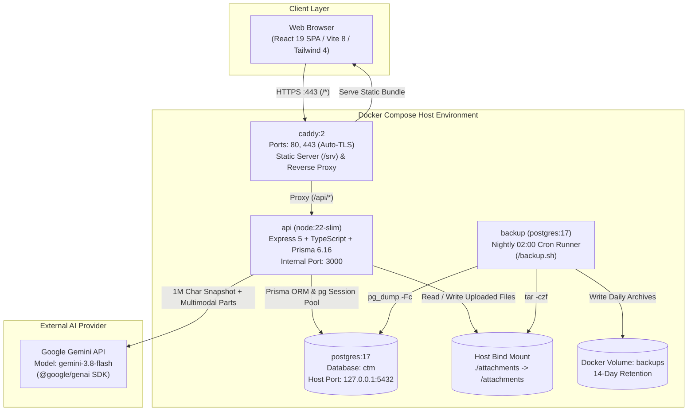
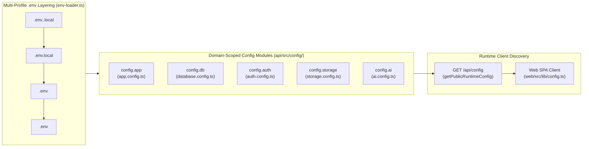
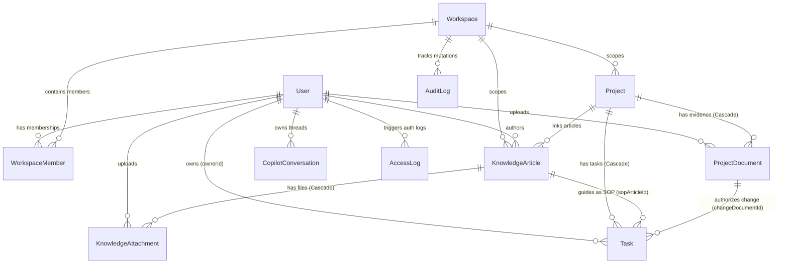
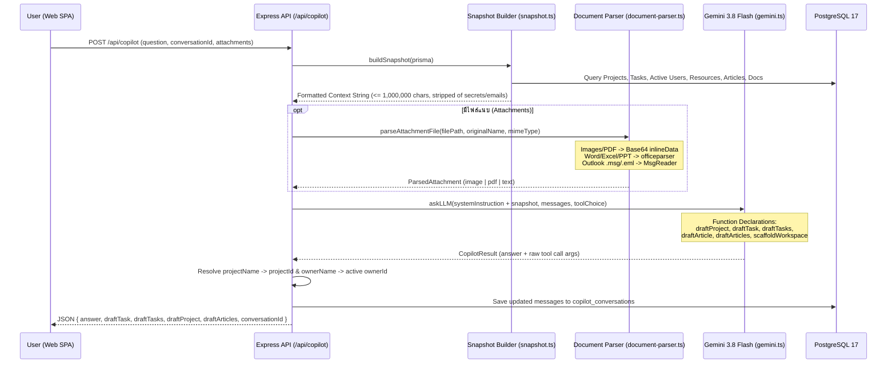

# เอกสารการออกแบบทางเทคนิค (Technical Design Document - TDD)

**ชื่อระบบ:** Cloud Team Management (CTM)  
**รหัสเอกสาร:** CTM-TDD-FINAL-v1.0  
**สถานะเอกสาร:** 🟢 อนุมัติและตรงกับโค้ดใช้งานจริง (Approved & Verified Against Production Codebase)  
**วันที่อัปเดตล่าสุด:** 23 ตุลาคม 2026  
**อ้างอิงเอกสารที่เกี่ยวข้อง:** [`BRD.md`](./BRD.md), [`PRD.md`](./PRD.md), [`DEPLOY.md`](./DEPLOY.md), [`VALIDATION.md`](../VALIDATION.md)  

---

## 1. สถาปัตยกรรมระบบและโครงสร้างคอนเทนเนอร์ (System Architecture & Topology)

ระบบ CTM ออกแบบด้วยสถาปัตยกรรม **Self-Hosted Multi-Container Stack** ที่ทำงานประสานกันผ่านเครือข่ายภายในของ Docker Compose โดยมี **Caddy 2** ทำหน้าที่เป็น Edge Reverse Proxy และให้บริการไฟล์ Static ของ **React 19 SPA** ในขณะที่คำขอภายใต้พาธ `/api/*` ทั้งหมดจะถูกส่งต่อไปยัง **Node.js Express 5 API** ซึ่งเชื่อมต่อกับฐานข้อมูล **PostgreSQL 17** และพื้นที่จัดเก็บไฟล์แนบในเครื่องแม่ข่าย (`./attachments`)



---

## 2. รายละเอียดเทคโนโลยีและไลบรารี (Technology Stack Specification)

### 2.1 Backend API (`api/`)
- **Runtime & Language:** Node.js `>=22.13.0` (ES Modules `"type": "module"`), TypeScript `5.9.3`
- **Web Framework:** Express `5.1.0`
- **ORM & Database Driver:** Prisma ORM `6.16.0` (`@prisma/client`), `pg` `8.16.0`
- **Session Management:** `express-session` `1.18.2` ร่วมกับ `connect-pg-simple` `10.0.0` (เก็บ Session ในตาราง `session` ของ PostgreSQL)
- **Multipart File Upload:** `multer` `2.0.2` (จำกัดขนาดไฟล์ 25 MB ต่อไฟล์)
- **AI & Multimodal Parsing:**
  - `@google/genai` `^2.21.0` (เชื่อมต่อโมเดล `gemini-3.8-flash`)
  - `officeparser` `^7.8.0` (สกัดข้อความจาก `.docx`, `.xlsx`, `.pptx`, `.odt`, `.ods`, `.odp`, `.rtf`)
  - `@kenjiuno/msgreader` `^1.28.0` (สกัดข้อความและหัวจดหมายจากไฟล์ Outlook `.msg`)
- **Test Runner:** Node.js Built-in Test Runner รันผ่าน `tsx --test --test-concurrency=1`

### 2.2 Frontend Web SPA (`web/`)
- **Framework & Bundler:** React `19.2.6`, Vite `8.0.13`, TypeScript `5.9.3`
- **Styling & UI Components:** Tailwind CSS `4.2.1` (`@tailwindcss/postcss`), `@base-ui/react` `1.7.0`, `@shadcn/react`, `lucide-react` `1.31.0`, `recharts` `3.8.0`, `react-resizable-panels` `4.5.8`
- **Markdown & Document Viewers:** `react-markdown` `^10.1.0`, `remark-gfm` `^4.0.1`, `read-excel-file` `^9.3.10`
- **Test Runner:** `node --test src/lib/*.test.mjs` (ทดสอบ Pure Logic Modules โดยตรง)

### 2.3 สถาปัตยกรรมการตั้งค่าระบบแบบ Modernized Modular Configuration (`api/src/config/`)
ระบบได้เปลี่ยนผ่านจากรูปแบบ Monolithic Config ไปสู่สถาปัตยกรรม **12-Factor Domain-Scoped Configuration** ภายใต้ไดเรกทอรี [`api/src/config/`](../api/src/config/) (อ้างอิง [`ADR-0012`](./adr/0012-modernized-modular-configuration-architecture.md)):



1. **Multi-Profile Environment Loader ([`api/src/config/env-loader.ts`](../api/src/config/env-loader.ts)):**
   - โหลดไฟล์ตามลำดับความสำคัญ: `.env.<NODE_ENV>.local` → `.env.local` → `.env.<NODE_ENV>` → `.env` พร้อมตัวแปลงชนิดข้อมูล (`envString`, `envInt`, `envBool`, `envList`)
2. **การแยกโมดูลตามขอบเขตโดเมน (Domain-Scoped Namespaces ใน [`api/src/config/index.ts`](../api/src/config/index.ts)):**
   - **`config.app`** ([`app.config.ts`](../api/src/config/app.config.ts)): โหมดสภาพแวดล้อม (`isProduction`, `isTest`, `isDevelopment`), `domain`, `port`, `jsonBodyLimit`, `trustProxy`
   - **`config.db`** ([`database.config.ts`](../api/src/config/database.config.ts)): ข้อมูลเชื่อมต่อ PostgreSQL, `poolMax`, และการประกอบ `DATABASE_URL` อัตโนมัติแยกตามฐานข้อมูลจริง (`ctm`) และฐานข้อมูลทดสอบ (`ctm_test`)
   - **`config.auth`** ([`auth.config.ts`](../api/src/config/auth.config.ts)): `sessionSecret`, `cookieSecure`, `cookieSameSite`, `loginRateLimitMax`, `loginRateLimitWindowMinutes`, `passwordMinLength`, และบัญชี Admin เริ่มต้น
   - **`config.storage`** ([`storage.config.ts`](../api/src/config/storage.config.ts)): `attachmentsDir`, `maxAttachmentBytes`, `maxCopilotFileBytes`, ชุดนามสกุลไฟล์ที่อนุญาต (`allowedAttachmentExts`, `allowedCopilotExts`), และ `backupRetentionDays`
   - **`config.ai`** ([`ai.config.ts`](../api/src/config/ai.config.ts)): `apiKey`, `isEnabled`, `model` (`gemini-3.8-flash`), `snapshotBudget`, `maxQuestionLength`
3. **Runtime Public Config Discovery (`GET /api/config` & [`web/src/lib/config.ts`](../web/src/lib/config.ts)):**
   - ให้บริการค่ากำหนดฝั่งไคลเอนต์ผ่าน `config.getPublicRuntimeConfig()` โดยคัดกรองความลับออกทั้งหมด (ไม่ส่ง `sessionSecret`, `adminPassword`, หรือ `apiKey` ออกไป)

| ตัวแปรใน `.env` | ค่าที่กำหนดใน `.env` ปัจจุบัน | โดเมนโมดูล (`config.*`) | คำอธิบายหน้าที่การทำงาน |
|---|---|---|---|
| **`DOMAIN`** | `localhost` | `config.app.domain` | โดเมนสำหรับออกใบรับรอง HTTPS อัตโนมัติผ่าน Caddy |
| **`PORT`** | `3000` | `config.app.port` | พอร์ตภายในที่ Express API เปิดรับการเชื่อมต่อ |
| **`POSTGRES_USER`** | `postgres` | `config.db.user` | ชื่อบัญชีผู้ใช้ฐานข้อมูล PostgreSQL 17 |
| **`POSTGRES_PASSWORD`** | *(กำหนดใน `.env`)* | `config.db.password` | รหัสผ่านฐานข้อมูล PostgreSQL |
| **`POSTGRES_HOST`** | `127.0.0.1` *(หรือ `postgres` ใน Docker)* | `config.db.host` | โฮสต์ของฐานข้อมูลสำหรับการเชื่อมต่อจากเครื่องแม่ข่าย |
| **`POSTGRES_PORT`** | `5432` | `config.db.port` | พอร์ตเชื่อมต่อฐานข้อมูล PostgreSQL |
| **`POSTGRES_DB`** | `ctm` | `config.db.dbName` | ชื่อฐานข้อมูลหลักสำหรับรันระบบจริง |
| **`POSTGRES_TEST_DB`** | `ctm_test` | `config.db.testDbName` | ชื่อฐานข้อมูลแยกเฉพาะสำหรับรัน Automated Integration Tests |
| **`SESSION_SECRET`** | *(กำหนดใน `.env`)* | `config.auth.sessionSecret` | คีย์ลับสำหรับเข้ารหัสลายเซ็นคุกกี้ Session (`express-session`) |
| **`LOGIN_RATE_LIMIT_MAX`** | `10` | `config.auth.loginRateLimitMax` | จำนวนครั้งสูงสุดที่อนุญาตให้พยายามล็อกอินต่อหน้าต่างเวลา |
| **`LOGIN_RATE_LIMIT_WINDOW_MINUTES`** | `15` | `config.auth.loginRateLimitWindowMinutes` | ระยะเวลาหน้าต่างการบล็อก Rate Limit การล็อกอิน (นาที) |
| **`JSON_BODY_LIMIT`** | `256kb` | `config.app.jsonBodyLimit` | ขนาดสูงสุดของ JSON Request Payload (`express.json`) |
| **`ADMIN_EMAIL`** | `you@example.com` | `config.auth.adminEmail` | อีเมลของผู้ดูแลระบบคนแรกที่สร้างอัตโนมัติเมื่อเริ่มต้นระบบ (Seed) |
| **`ADMIN_PASSWORD`** | *(กำหนดใน `.env`)* | `config.auth.adminPassword` | รหัสผ่านเริ่มต้นของผู้ดูแลระบบคนแรก (เข้ารหัสด้วย `scrypt`) |
| **`ATTACHMENTS_DIR`** | `./attachments-dev` *(หรือ `/attachments` ใน Docker)* | `config.storage.attachmentsDir` | พาธโฟลเดอร์สำหรับจัดเก็บไฟล์แนบและเอกสารหลักฐานโครงการ |
| **`MAX_ATTACHMENT_BYTES`** | `26214400` *(25 MB)* | `config.storage.maxAttachmentBytes` | ขนาดไฟล์สูงสุดต่อไฟล์สำหรับเอกสารโครงการและบทความความรู้ |
| **`MAX_COPILOT_FILE_BYTES`** | `15728640` *(15 MB)* | `config.storage.maxCopilotFileBytes` | ขนาดไฟล์สูงสุดต่อไฟล์สำหรับการอัปโหลดเข้า AI Copilot |
| **`GEMINI_API_KEY`** | *(กำหนดใน `.env`)* | `config.ai.apiKey` | API Key สำหรับเชื่อมต่อบริการ Google Gemini API |
| **`GEMINI_MODEL`** | `gemini-3.8-flash` | `config.ai.model` | ชื่อโมเดล AI ที่ใช้ประมวลผล Copilot และสกัดข้อมูล Multimodal |
| **`COPILOT_SNAPSHOT_BUDGET`** | `1000000` *(1 ล้านตัวอักษร)* | `config.ai.snapshotBudget` | งบประมาณขนาดข้อมูลบริบท Workspace สูงสุดที่ส่งให้ AI Copilot |

---

## 3. การออกแบบฐานข้อมูลและโครงสร้างข้อมูล (Database Schema & ER Diagram)

ฐานข้อมูล PostgreSQL 17 ถูกจัดการผ่าน [`api/prisma/schema.prisma`](../api/prisma/schema.prisma) ประกอบด้วย 12 โมเดลหลัก (และตาราง `session` ที่สร้างอัตโนมัติโดย `connect-pg-simple`):



### รายละเอียดตารางฐานข้อมูล (Table Specifications)

| ชื่อโมเดล (ตาราง SQL) | คีย์หลักและฟิลด์สำคัญ | ความสัมพันธ์และกฎระดับฐานข้อมูล |
|---|---|---|
| **`User`** (`users`) | `id` (UUID), `email` (Unique), `passwordHash`, `name`, `title`, `role` (`admin`\|`member`\|`auditor`), `isActive` (Boolean) | ห้าม Hard Delete เมื่อมีงานผูกอยู่ ใช้การตั้งค่า `isActive = false` แทน |
| **`Workspace`** (`workspaces`) | `id` (UUID), `name`, `type`, `description`, `color`, `icon` | แยกข้อมูลโครงการ บทความ และ Audit Log ตามพื้นที่ทำงาน |
| **`WorkspaceMember`** (`workspace_members`) | `id`, `workspaceId`, `userId`, `role` (`admin`\|`lead`\|`member`\|`auditor`\|`viewer`) | Unique Index คู่ `[workspaceId, userId]`, `onDelete: Cascade` |
| **`Project`** (`projects`) | `id`, `workspaceId`, `name`, `description`, `status`, `progress` (0–100), `department`, `due`, `color`, `year` | การลบโครงการจะลบ `tasks` และ `project_documents` ภายใต้โครงการนั้นแบบ Cascade |
| **`Task`** (`tasks`) | `id`, `projectId`, `name`, `description`, `ownerId`, `phase`, `status`, `priority`, `start`, `date`, `sopArticleId`, `changeDocumentId` | ผูกกับผู้รับผิดชอบ (`ownerId`), คู่มือ SOP (`sopArticleId`), และเอกสารอนุมัติเปลี่ยนแปลง (`changeDocumentId`) |
| **`ProjectDocument`** (`project_documents`) | `id`, `projectId`, `storedName` (Unique), `originalName`, `mimeType`, `sizeBytes`, `category` (`CRA`\|`Diagram`\|`RBAC`\|`CR`\|`CC`\|`TestEvidence`\|`General`), `referenceNo`, `uploadedById` | เก็บไฟล์จริงที่ `/attachments/<storedName>` |
| **`KnowledgeArticle`** (`knowledge_articles`) | `id`, `workspaceId`, `isGlobal`, `name`, `category`, `body`, `format` (`markdown`\|`html`), `chatHistory` (JSON), `authorId`, `projectId` | รองรับทั้งบทความเฉพาะ Workspace และบทความส่วนกลาง (`isGlobal = true`) |
| **`KnowledgeCategory`** (`knowledge_categories`) | `id`, `name` (Unique), `color`, `icon` | หมวดหมู่บทความแบบไดนามิก |
| **`KnowledgeAttachment`** (`knowledge_attachments`) | `id`, `articleId`, `storedName` (Unique), `originalName`, `mimeType`, `sizeBytes`, `uploadedById` | ลบอัตโนมัติเมื่อบทความถูกลบ (`onDelete: Cascade`) |
| **`CloudResource`** (`cloud_resources`) | `id`, `name`, `provider`, `type`, `status`, `monthlyCost` (Int) | เก็บข้อมูลทรัพยากรคลาวด์และค่าใช้จ่ายรายเดือน |
| **`CopilotConversation`** (`copilot_conversations`) | `id`, `title`, `userId`, `messages` (JSON Array) | เก็บประวัติการสนทนาหลายเทิร์นของผู้ใช้แต่ละคน |
| **`AccessLog`** (`access_logs`) | `id`, `userId`, `email`, `action` (`LOGIN_SUCCESS`\|`LOGIN_FAILURE`\|`LOGOUT`\|`PASSWORD_CHANGE`), `ipAddress`, `userAgent`, `failureReason`, `createdAt` | **Immutable Append-Only:** ไม่มี Endpoint สำหรับแก้ไขหรือลบ |
| **`AuditLog`** (`audit_logs`) | `id`, `workspaceId`, `actorId`, `actorName`, `actorRole`, `action`, `entityType`, `entityId`, `details` (JSON Diff), `createdAt` | **Immutable Append-Only:** ไม่มี Endpoint สำหรับแก้ไขหรือลบ |

---

## 4. สถาปัตยกรรมความมั่นคงปลอดภัยและการพิสูจน์ตัวตน (Security & Auth Design)

### 4.1 การเข้ารหัสรหัสผ่าน (`api/src/passwords.ts`)
- ใช้โมดูล `node:crypto` (`scrypt`) โดยสร้าง Salt สุ่มขนาด 16 ไบต์ต่อรหัสผ่าน และใช้ `timingSafeEqual` ในการเปรียบเทียบ Hash เพื่อป้องกัน Timing Attack
- รูปแบบที่จัดเก็บในฟิลด์ `password_hash`: `<16-byte-hex-salt>:<64-byte-hex-derived-key>`

### 4.2 การจัดการ Session และการป้องกัน CSRF (`api/src/app.ts` & `api/src/middleware.ts`)
- **Session Store:** ใช้ `connect-pg-simple` เก็บสถานะ Session ใน PostgreSQL พร้อมตั้งค่าคุกกี้ `httpOnly: true`, `sameSite: 'lax'`, `secure: process.env.NODE_ENV === 'production'`, และ `rolling: true`
- **CSRF Origin Guard (`originCheck`):** สำหรับทุกคำขอที่ไม่ใช่ `GET`, `HEAD`, `OPTIONS` ระบบจะตรวจสอบเฮดเดอร์ `Origin` เทียบกับ `Host` และตรวจ `Sec-Fetch-Site` หากมาจาก Cross-Site จะถูกบล็อกด้วย `403 Cross-origin request blocked` ทันที
- **Login Rate Limiter (`loginRateLimit`):** จำกัดการพยายามล็อกอินผิดไม่เกิน **10 ครั้งภายในหน้าต่างเวลา 60 วินาที** ต่อคู่ `IP + Email` หากเกินจะตอบกลับ `429 Too many login attempts`

### 4.3 การบังคับใช้ Segregation of Duties (`requireAuditorReadOnly`)
- ติดตั้งเป็น Global Middleware ใน [`api/src/app.ts`](../api/src/app.ts#L72) ถัดจาก `/api/auth`
- หากผู้ใช้ใน Session มีบทบาทเป็น `auditor` และส่งคำขอที่ไม่ใช่ `GET`, `HEAD`, `OPTIONS` ระบบจะปฏิเสธคำขอด้วย `403 Forbidden: Auditor role has read-only access (ISO 27001 / BOT Segregation of Duties)` ทันที

### 4.4 การรัน Interactive HTML อย่างปลอดภัย (Sandboxed Iframe)
- บทความใน Knowledge Hub ที่มี `format === 'html'` จะถูกเรนเดอร์ภายใน `<iframe sandbox="allow-scripts">` โดย **ไม่เปิด** `allow-same-origin` ทำให้โค้ด JavaScript ภายในบทความถูกแยกขาดจาก Origin ของระบบหลัก ไม่สามารถอ่าน Cookie, LocalStorage หรือเรียก API ในนามผู้ใช้ได้

---

## 5. ข้อกำหนด REST API (API Specification Matrix)

| กลุ่มเส้นทาง (Route Group) | Method & Path | สิทธิ์ขั้นต่ำ | หน้าที่การทำงาน (Behavior) |
|---|---|---|---|
| **Health** | `GET /api/health` | Public | ตรวจสอบสถานะความพร้อมของ API (`{"ok": true}`) |
| **Config** (`config/index.ts`) | `GET /api/config` | Authenticated | คืนค่า Runtime Configuration ที่กรองความลับออกแล้ว (`app`, `limits`, `ai`) ให้ฝั่ง Web SPA |
| **Auth** (`auth.ts`) | `POST /api/auth/login` | Public (Rate Limited) | ตรวจสอบอีเมล/รหัสผ่าน บันทึก `AccessLog` และสร้าง Session |
| | `POST /api/auth/logout` | Authenticated | บันทึก `AccessLog (LOGOUT)` และทำลาย Session |
| | `GET /api/auth/me` | Authenticated | คืนค่าข้อมูลผู้ใช้ปัจจุบัน (`id`, `email`, `name`, `title`, `role`) |
| | `PATCH /api/auth/profile` | Authenticated | แก้ไขชื่อและตำแหน่งของตนเอง พร้อมบันทึก `AuditLog` |
| | `POST /api/auth/change-password` | Authenticated | ยืนยันรหัสผ่านเดิม ตั้งรหัสผ่านใหม่ (≥10 ตัวอักษร) และบันทึก `AccessLog` |
| | `GET /api/auth/login-history` | Authenticated | ดึงประวัติการล็อกอินสำเร็จ 5 ครั้งล่าสุดของตนเอง |
| **Users** (`users.ts`) | `GET /api/users` | Authenticated | ดึงรายชื่อผู้ใช้ทั้งหมดพร้อมคำนวณ `workload` สดจากจำนวนงานที่ยังไม่เสร็จ |
| | `POST /api/users` | Platform `admin` | สร้างผู้ใช้ใหม่และเพิ่มเข้า Default Workspace อัตโนมัติ |
| | `PATCH /api/users/:id` | Platform `admin` | แก้ไขข้อมูล/บทบาท/สถานะ `isActive` (มีระบบป้องกันการปิดหรือลดสิทธิ์ Admin คนสุดท้าย) |
| | `POST /api/users/:id/reset-password` | Platform `admin` | รีเซ็ตรหัสผ่านให้ผู้ใช้และลบ Session เดิมของผู้ใช้นั้น |
| **Workspaces** (`workspaces.ts`) | `GET /api/workspaces` | Authenticated | ดึงรายการ Workspace ที่ผู้ใช้เป็นสมาชิก (หรือทั้งหมดหากเป็น `admin`) |
| | `POST /api/workspaces` | Authenticated (Non-Auditor) | สร้าง Workspace ใหม่และตั้งผู้สร้างเป็น Workspace `admin` |
| | `PATCH /api/workspaces/:id` | Workspace `admin` | แก้ไขชื่อ คำอธิบาย ประเภท สี และไอคอนของ Workspace |
| | `DELETE /api/workspaces/:id` | Platform `admin` | ลบ Workspace (ไม่อนุญาตให้ลบ `default-workspace-engineering`) |
| | `POST /api/workspaces/:id/members` | Workspace `admin` | เพิ่มสมาชิกเข้า Workspace พร้อมกำหนดบทบาท |
| | `PATCH /api/workspaces/:id/members/:userId` | Workspace `admin` | เปลี่ยนบทบาทสมาชิกใน Workspace (มี Last-Admin Guard) |
| | `DELETE /api/workspaces/:id/members/:userId` | Workspace `admin` | ถอดสมาชิกออกจาก Workspace |
| **Projects** (`projects.ts`) | `GET /api/projects` | Authenticated | ดึงรายการโครงการ (กรองตาม `?workspaceId=` ได้) |
| | `POST /api/projects` | Non-Auditor | สร้างโครงการใหม่และบันทึก `AuditLog (CREATE)` |
| | `PATCH /api/projects/:id` | Non-Auditor | แก้ไขโครงการและบันทึก `AuditLog (UPDATE)` พร้อม Diff ก่อน-หลัง |
| | `DELETE /api/projects/:id` | Non-Auditor | ลบโครงการ (Cascade ลบงานและเอกสาร) และบันทึก `AuditLog (DELETE)` |
| **Tasks** (`tasks.ts`) | `GET /api/tasks` | Authenticated | ดึงรายการงานพร้อมชื่อเจ้าของ ชื่อโครงการ SOP และเลขที่เอกสาร CR/CC |
| | `POST /api/tasks` | Non-Auditor | สร้างงานใหม่ ตรวจสอบความถูกต้องของวันที่และสถานะเจ้าของงาน (`isActive`) |
| | `PATCH /api/tasks/:id` | Non-Auditor | แก้ไขสถานะ วันที่ เฟส คำอธิบาย SOP หรือเอกสาร CR/CC |
| | `DELETE /api/tasks/:id` | Non-Auditor | ลบงานและบันทึก `AuditLog` |
| **Project Docs** (`project-documents.ts`) | `GET /api/project-documents` | Authenticated | ดึงรายการเอกสารหลักฐานโครงการทั้งหมด (หรือเฉพาะ `/api/projects/:id/documents`) |
| | `POST /api/projects/:id/documents` | Non-Auditor | อัปโหลดไฟล์หลักฐานลง `/attachments` พร้อมระบุหมวดหมู่ (`CRA`, `Diagram`, `RBAC`, `CR`, `CC`, `TestEvidence`) |
| | `GET /api/project-documents/:id/download` | Authenticated | ดาวน์โหลดหรือดูตัวอย่างไฟล์ (`?inline=1`) |
| | `DELETE /api/project-documents/:id` | Uploader หรือ `admin` | ลบไฟล์ออกจากดิสก์และฐานข้อมูล (บล็อกสมาชิกคนอื่นด้วย `403`) |
| **Compliance** (`compliance.ts`) | `GET /api/compliance/matrix` | Authenticated | คำนวณผลตรวจความพร้อม 5 หมวดหมู่และอัตราการผูก CR/CC ของงาน Deployment ทุกโครงการ |
| **Knowledge** (`knowledge.ts` & `attachments.ts`) | `GET /api/knowledge` | Authenticated | ดึงบทความทั้งหมด (กรองตาม `workspaceId` ร่วมกับบทความ `isGlobal`) |
| | `POST /api/knowledge` | Non-Auditor | สร้างบทความ (`markdown` หรือ `html`) |
| | `PATCH /api/knowledge/:id` | Non-Auditor | แก้ไขบทความและบันทึก `chatHistory` ของ Copilot ประจำบทความ |
| | `DELETE /api/knowledge/:id` | Non-Auditor | ลบบทความและลบไฟล์แนบในดิสก์ทั้งหมด |
| | `GET\|POST\|PATCH\|DELETE /api/knowledge/categories` | Authenticated / Non-Auditor | จัดการหมวดหมู่บทความและอัปเดตชื่อหมวดหมู่ในบทความที่เกี่ยวข้องอัตโนมัติ |
| | `POST /api/knowledge/:id/attachments` | Non-Auditor | อัปโหลดไฟล์แนบประกอบบทความ |
| **Copilot** (`copilot.ts`) | `GET /api/copilot/status` | Authenticated | คืนค่าสถานะการตั้งค่า `GEMINI_API_KEY` (`{ enabled: boolean }`) |
| | `POST /api/copilot/upload` | Non-Auditor | อัปโหลดไฟล์เข้า Copilot เพื่อเตรียมสกัดข้อมูล Multimodal |
| | `POST /api/copilot` | Authenticated | ส่งคำถาม ประวัติแชต และไฟล์แนบเข้า Gemini 3.8 Flash พร้อมแปลง Tool Calls เป็น Drafts |
| | `POST /api/copilot/article` | Non-Auditor | ผู้ช่วย AI เขียนหรือแปลงบทความในหน้าต่าง Knowledge Editor |
| | `GET\|POST\|PATCH\|DELETE /api/copilot/conversations` | Authenticated | จัดการห้องสนทนาที่บันทึกไว้ของผู้ใช้ |
| **Logs** (`logs.ts`) | `GET /api/logs/audit` | `admin` หรือ `auditor` | ดึงบันทึก `AuditLog` (รองรับการกรองและ `?format=csv`) |
| | `GET /api/logs/access` | `admin` หรือ `auditor` | ดึงบันทึก `AccessLog` (รองรับการกรองและ `?format=csv`) |

---

## 6. กระบวนการทำงานเชิงเทคนิคของ AI Copilot (AI Copilot Technical Pipeline)



### จุดเด่นทางวิศวกรรมของระบบ Copilot
1. **Context Budget & HTML Sanitization (`api/src/copilot/snapshot.ts`):**
   - กำหนดงบประมาณขนาด Snapshot สูงสุดที่ `1,000,000` ตัวอักษร (~250,000 โทเคน)
   - สำหรับบทความประเภท `html` ระบบจะใช้ฟังก์ชัน `cleanHtmlForContext()` เพื่อตัดแท็ก `<script>` และ `<style>` ขนาดใหญ่ออกก่อนนำเข้า Snapshot ช่วยประหยัดโทเคนและคงไว้เฉพาะเนื้อหาสำคัญ
2. **Dependency Injection สำหรับการทดสอบ (`AskLLM` Interface):**
   - ฟังก์ชัน `createApp(prisma, { askLLM })` เปิดให้ฉีด Fake `askLLM` เข้ามาในระหว่างการรัน Automated Tests ทำให้สามารถทดสอบการแปลงชื่อโครงการ ชื่อเจ้าของงาน การจัดการ Error 502/503 และการบันทึกประวัติสนทนาได้ครบ 100% โดยไม่ต้องเชื่อมต่ออินเทอร์เน็ตหรือใช้ API Key จริง

---

## 7. สถาปัตยกรรม Frontend และโมดูลคำนวณบริสุทธิ์ (Frontend & Pure Logic Architecture)

เพื่อให้โค้ดฝั่ง Frontend มีความเสถียรและทดสอบด้วย Unit Test ได้อย่างรวดเร็ว ตรรกะการคำนวณทั้งหมดจึงถูกแยกออกมาเป็น **Pure ES Modules (`.mjs`)** ในไดเรกทอรี [`web/src/lib/`](../web/src/lib/) โดยไม่ผูกติดกับ React DOM:

| ไฟล์โมดูล (`web/src/lib/`) | หน้าที่และอัลกอริทึมสำคัญ | ชุดทดสอบคู่ขนาน |
|---|---|---|
| **`gantt.mjs`** | คำนวณตำแหน่งแถบงานบนปฏิทินข้ามเดือน (`buildGanttModel`), คำนวณการลากเลื่อนวัน (`calculateDragDates`), เลื่อนงานทั้งเฟส (`shiftPhaseTasks`), และตรวจสอบความถูกต้องของวันที่ (`validateTaskDates`) | `gantt.test.mjs` |
| **`workspace.mjs`** | กรองรายการโครงการและงานตามคำค้นหา สถานะ และปีงบประมาณ (`filterItems`), และคำนวณภาระงานสมาชิก (`computeWorkload`: งานที่ยังไม่เสร็จ × 20%, สูงสุด 100%) | `workspace.test.mjs` |
| **`compliance.mjs`** | คำนวณคะแนนความพร้อมของโครงการเทียบกับเกณฑ์ ISO 27001 / ธปท. ทั้ง 5 ข้อ และตรวจสอบสัดส่วนงาน Deployment ที่ผูกใบ CR/CC (`evaluateProjectCompliance`) | `compliance.test.mjs` |
| **`toc.mjs`** | สกัดสารบัญหัวข้อ `H1`–`H3` จาก Markdown โดยข้ามบล็อกโค้ด (`extractTableOfContents`), คำนวณเวลาอ่าน (`estimateReadingTime`), และแยกวิเคราะห์ไฟล์นำเข้า (`parseImportedFile`) | `toc.test.mjs` |
| **`search.mjs`** | ค้นหาบทความแบบหลายคำค้น (`filterArticles`), แยกส่วนข้อความเพื่อไฮไลต์คำตรงกัน (`highlightMatches`), และตัดข้อความย่อรอบจุดที่พบคำค้น (`snippetWithMatch`) | `search.test.mjs` |
| **`workspace-rbac.mjs`** | ตรวจสอบสิทธิ์การดำเนินการตามบทบาทใน Workspace (`canMutateWorkspace`, `canManageWorkspaceMembers`) และกรองบันทึก Audit/Access Logs | `workspace-rbac.test.mjs` |
| **`copilot-helpers.mjs` & `copilot-article.mjs`** | จัดรูปแบบชุดงาน Batch Drafts, สกัดชื่อรายงานผู้บริหาร, จัดกลุ่มห้องสนทนาตามวัน, และสร้าง Prompt สำหรับเขียนบทความ | `copilot-helpers.test.mjs`, `copilot-article.test.mjs` |
| **`csv.mjs`** | แยกวิเคราะห์ข้อมูลไฟล์ CSV ตามมาตรฐาน RFC 4180 รองรับเครื่องหมายอัญประกาศซ้อน (`parseCSV`) สำหรับแสดงตัวอย่างตารางในหน้าเอกสาร | `csv.test.mjs` |

---

## 8. โครงสร้างพื้นฐาน การติดตั้ง และแผนสำรองข้อมูล (Infrastructure & Disaster Recovery)

### 8.1 กระบวนการ Build แบบ Multi-Stage (`api/Dockerfile` & `caddy/Dockerfile`)
- **`caddy/Dockerfile`:**
  - *Stage 1 (`webbuild`):* ใช้ `node:22-slim` รัน `npm ci` และ `npm run build` (ตรวจ `tsc --noEmit` และแพ็กไฟล์ด้วย `vite build`)
  - *Stage 2:* ใช้ `caddy:2` คัดลอก `Caddyfile` และผลลัพธ์จาก `/web/dist` ไปไว้ที่ `/srv`
- **`api/Dockerfile`:**
  - *Stage 1 (`build`):* ติดตั้ง OpenSSL รัน `npm ci`, `npx prisma generate`, และคอมไพล์ TypeScript ด้วย `npm run build`
  - *Stage 2:* ติดตั้งเฉพาะ Production Dependencies (`npm ci --omit=dev`) และรันคำสั่งเริ่มต้น:
    ```sh
    npx prisma migrate deploy && node dist/prisma/seed.js && node dist/src/index.js
    ```

### 8.2 ระบบสำรองข้อมูลอัตโนมัติและการกู้คืน (`backup/backup.sh`)
- คอนเทนเนอร์ `backup` ทำงานคู่ขนานและรันสคริปต์สำรองข้อมูลทุกวันเวลา **02:00 น.** (และรันทันทีเมื่อสั่งระบุอาร์กิวเมนต์ `now`):
  1. ดัมพ์ฐานข้อมูลแบบ Custom Compressed Format: `pg_dump -Fc > /backups/$STAMP/ctm.dump`
  2. บีบอัดไฟล์แนบทั้งหมด: `tar -czf /backups/$STAMP/attachments.tar.gz -C /attachments .`
  3. ลบโฟลเดอร์สำรองข้อมูลที่มีอายุเกิน **14 วัน** อัตโนมัติ (`find /backups -mindepth 1 -maxdepth 1 -type d -mtime +14 -exec rm -rf {} +`)

---

## 9. กลยุทธ์การทดสอบและหลักฐานการตรวจสอบคุณภาพ (Testing & Verification Strategy)

ระบบใช้แนวทาง **Test-Driven Verification (TDD)** โดยมีชุดทดสอบอัตโนมัติรวม **123 เคส** ที่ตรวจสอบผ่าน 100%:

1. **Web Pure Logic Unit Tests (`npm --prefix web test`):**
   - จำนวน **60 เคส** รันเสร็จภายใน `< 100ms`
   - ครอบคลุมตรรกะ Gantt, Compliance Matrix, TOC, Search, CSV, Copilot Helpers, และ RBAC
2. **API Integration Tests (`npm --prefix api test`):**
   - จำนวน **63 เคส** (ใน 24 ไฟล์ทดสอบภายใต้ [`api/test/`](../api/test/))
   - โหลดค่ากำหนดจาก `.env` และประกอบ Connection String เข้ากับฐานข้อมูล PostgreSQL 17 จริง (`ctm_test`) อัตโนมัติผ่าน [`api/src/config/`](../api/src/config/)
   - ครอบคลุมการพิสูจน์ตัวตน, CSRF, Rate Limit, การป้องกัน Auditor แก้ไขข้อมูล, การห้ามลบ Admin คนสุดท้าย, การคำนวณ Workload, การอัปโหลดและจำกัดสิทธิ์ลบเอกสาร, การสร้าง Snapshot, การทำงานของ AI Copilot, และการตรวจสอบ Domain-Scoped Config (`GET /api/config`)

---

## 10. ดัชนีบันทึกการตัดสินใจทางสถาปัตยกรรม (Architecture Decision Records - ADRs)

| รหัส ADR | หัวข้อการตัดสินใจทางสถาปัตยกรรม | ไฟล์อ้างอิง |
|---|---|---|
| **ADR-0001** | ผู้ดูแลระบบเป็นผู้รีเซ็ตรหัสผ่านโดยไม่เชื่อมระบบอีเมลภายนอก และใช้นโยบายระงับบัญชีแทนการลบ | [`0001-admin-resets-passwords-no-email-service.md`](./adr/0001-admin-resets-passwords-no-email-service.md) |
| **ADR-0002** | การคำนวณภาระงานสมาชิกแบบไดนามิก (Dynamic Workload Derivation) ขณะดึงข้อมูลแทนการเก็บค่าคงที่ | [`0002-dynamic-workload-derivation.md`](./adr/0002-dynamic-workload-derivation.md) |
| **ADR-0003** | การเพิ่มบทบาท `auditor` แบบ Read-Only เพื่อบังคับใช้ Segregation of Duties ตามมาตรฐาน ISO 27001 และ ธปท. | [`0003-auditor-role-for-iso27001-bot-compliance.md`](./adr/0003-auditor-role-for-iso27001-bot-compliance.md) |
| **ADR-0004** | การเชื่อมโยงงาน (Task) เข้ากับเอกสารอนุมัติการเปลี่ยนแปลง (`CR`/`CC`) และคู่มือ SOP | [`0004-task-change-traceability-to-project-documents.md`](./adr/0004-task-change-traceability-to-project-documents.md) |
| **ADR-0005** | ธรรมาภิบาลการลบเอกสารหลักฐานโครงการ (อนุญาตเฉพาะผู้อัปโหลดหรือ Admin เท่านั้น) | [`0005-project-document-deletion-governance.md`](./adr/0005-project-document-deletion-governance.md) |
| **ADR-0006** | ระบบอ่านบทความพร้อมสารบัญอัตโนมัติ (TOC Scrollspy) และโหมดมุมมองกว้าง (Wide View) | [`0006-knowledge-article-reader-with-toc-and-wide-view.md`](./adr/0006-knowledge-article-reader-with-toc-and-wide-view.md) |
| **ADR-0007** | การรองรับบทความ Interactive HTML ใน Sandboxed Iframe, หมวดหมู่ไดนามิก และระบบนำเข้าไฟล์ | [`0007-knowledge-interactive-html-custom-categories-and-importer.md`](./adr/0007-knowledge-interactive-html-custom-categories-and-importer.md) |
| **ADR-0008** | ผู้ช่วย AI Copilot ร่วมเขียนและแปลงบทความแบบ Side-by-Side ในหน้าต่าง Knowledge Editor | [`0008-knowledge-article-copilot-authoring-and-editing.md`](./adr/0008-knowledge-article-copilot-authoring-and-editing.md) |
| **ADR-0009** | การสกัดชุดงานแบบกลุ่ม (Batch Task Proposals) และการสร้างรายงานผู้บริหารด้วย Agentic Copilot | [`0009-agentic-copilot-batch-tasks-and-executive-reporting.md`](./adr/0009-agentic-copilot-batch-tasks-and-executive-reporting.md) |
| **ADR-0010** | การจัดเก็บประวัติการสนทนาของ AI Copilot ลงฐานข้อมูล PostgreSQL | [`0010-copilot-conversation-history-persistence.md`](./adr/0010-copilot-conversation-history-persistence.md) |
| **ADR-0011** | สถาปัตยกรรม Multi-Workspace RBAC และบันทึกประวัติความปลอดภัยแบบแก้ไขไม่ได้ (`AccessLog` & `AuditLog`) | [`0011-multi-workspace-rbac-and-audit-access-logs.md`](./adr/0011-multi-workspace-rbac-and-audit-access-logs.md) |
| **ADR-0012** | สถาปัตยกรรมการตั้งค่าระบบแบบ Modernized Modular Configuration (12-Factor & Domain-Scoped Config) | [`0012-modernized-modular-configuration-architecture.md`](./adr/0012-modernized-modular-configuration-architecture.md) |
