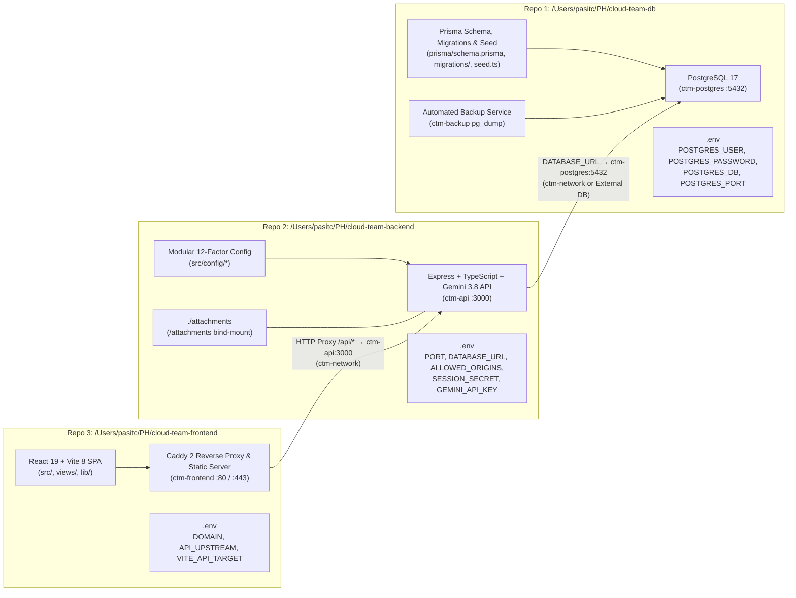

# Implementation Plan: Decoupled 3-Repository Architecture (`cloud-team-db`, `cloud-team-backend`, `cloud-team-frontend`)

- **Date:** 2026-10-23
- **Branch:** `feat/split-db-backend-frontend`
- **ADR:** [`0014-decoupled-3-repos-db-backend-frontend.md`](../../adr/0014-decoupled-3-repos-db-backend-frontend.md)

---

## 1. Target Multi-Repository Topology

---

## 2. Step-by-Step Execution Plan

### Task 1: Create Standalone Database Project (`/Users/pasitc/PH/cloud-team-management/cloud-team-db`)
- **Directory:** `/Users/pasitc/PH/cloud-team-management/cloud-team-db`
- **Files Created:**
  - `compose.yml` — Provisions `ctm-postgres` (`postgres:17`), `ctm-backup`, named volumes (`ctm_pgdata`, `ctm_backups`), and shared bridge network `ctm-network`.
  - `prisma/schema.prisma`, `prisma/migrations/*`, `prisma/seed.ts` — Database schema, migration history, and idempotent seed script.
  - `backup/backup.sh` — Daily `pg_dump -Fc` backup script.
  - `package.json` & `tsconfig.json` — Standalone scripts: `npm run db:migrate`, `npm run db:seed`, `npm run db:studio`, `npm run db:up`, `npm run db:down`.
  - `.env`, `.env.example`, `.gitignore`, `README.md`.
- **Git Workflow:**
  - Initialize Git repo (`git init -b main`), create branch `feat/standalone-db`, commit all files, verify migrations & seed against `ctm-postgres`.

---

### Task 2: Create Standalone Backend Project (`/Users/pasitc/PH/cloud-team-management/cloud-team-backend`)
- **Directory:** `/Users/pasitc/PH/cloud-team-management/cloud-team-backend`
- **Files Created:**
  - `src/**` — Express API routes, services, Gemini 3.8 Flash Copilot, and modular 12-Factor config (`src/config/*`).
  -Enhance `src/config/app.config.ts` and `src/middleware.ts` to support `ALLOWED_ORIGINS` (comma-separated allowed origins for CORS & CSRF `originCheck`) so Frontend and Backend can run on separate ports/domains cleanly.
  - `prisma/schema.prisma` — Prisma client schema for `@prisma/client` generation.
  - `test/**` — Full 63-test integration suite (`test/*.test.ts`).
  - `Dockerfile` — Self-contained multi-stage Dockerfile (`context: .`).
  - `compose.yml` — Standalone `ctm-api` service joining external `ctm-network` and connecting to PostgreSQL via `DATABASE_URL` (no bundled DB container).
  - `package.json`, `tsconfig.json`, `.env`, `.env.example`, `.gitignore`, `README.md`.
- **Git Workflow & Verification:**
  - Initialize Git repo (`git init -b main`), create branch `feat/standalone-backend`, run `npm run build` and `npm test` (`config.test.ts`, `resources.test.ts`, `compliance-matrix.test.ts`), and commit cleanly.

---

### Task 3: Create Standalone Frontend Project (`/Users/pasitc/PH/cloud-team-management/cloud-team-frontend`)
- **Directory:** `/Users/pasitc/PH/cloud-team-management/cloud-team-frontend`
- **Files Created:**
  - `src/**` — Modularized React 19 SPA (`src/App.tsx`, `src/views/*`, `src/components/*`, `src/lib/*`).
  - Enhance `src/lib/api.ts` and `src/lib/config.ts` to respect `VITE_API_BASE_URL` when calling backend endpoints directly or via reverse proxy.
  - `Dockerfile` — Self-contained multi-stage Dockerfile (`context: .`) building the Vite SPA and serving via Caddy 2.
  - `Caddyfile` — Reverse proxy forwarding `/api/*` to `{$API_UPSTREAM:ctm-api:3000}` and serving static SPA assets with gzip compression.
  - `compose.yml` — Standalone `ctm-frontend` service joining `ctm-network`.
  - `package.json`, `vite.config.ts`, `tsconfig.json`, `.env`, `.env.example`, `.gitignore`, `README.md`.
- **Git Workflow & Verification:**
  - Initialize Git repo (`git init -b main`), create branch `feat/standalone-frontend`, run `npm test` (60/60 pass) and `npm run build` (0 warnings), and commit cleanly.

---

### Task 4: Live Multi-Repo Docker Orchestration & End-to-End Verification
- **Steps:**
  1. Stop the old monolithic stack in `/Users/pasitc/PH/cloud-team-management` (`docker compose down`).
  2. Start **Repo 1 (`cloud-team-db`)**: `docker compose -f /Users/pasitc/PH/cloud-team-db/compose.yml up -d` -> verify `ctm-postgres` healthy and apply migrations/seed.
  3. Start **Repo 2 (`cloud-team-backend`)**: `docker compose -f /Users/pasitc/PH/cloud-team-backend/compose.yml up -d --build` -> verify `ctm-api` healthy on `http://localhost:3000/api/health`.
  4. Start **Repo 3 (`cloud-team-frontend`)**: `docker compose -f /Users/pasitc/PH/cloud-team-frontend/compose.yml up -d --build` -> verify `ctm-frontend` healthy and `https://localhost/api/health` returns `{"ok":true}` through Caddy -> Backend -> DB.
  5. Add a convenience orchestration script `scripts/stack-ctl.sh` in `/Users/pasitc/PH/cloud-team-management` and record full verification evidence in `VALIDATION.md`.
