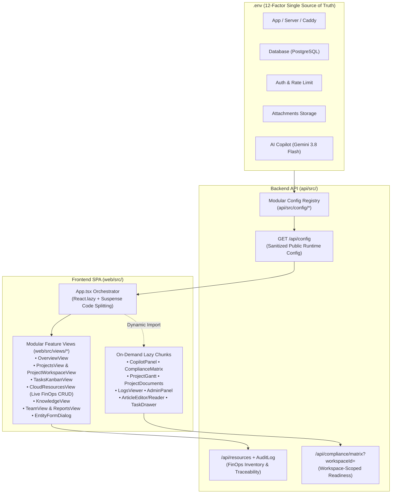

# Platform Modernization: Modular Config, Modular Views, Lazy Code Splitting & Live FinOps Governance

- **Date:** 2026-10-23
- **Branch:** `feat/platform-modernization`
- **ADRs:**
  - [`0012-modernized-modular-configuration-architecture.md`](../../adr/0012-modernized-modular-configuration-architecture.md)
  - [`0013-frontend-modular-views-and-lazy-code-splitting.md`](../../adr/0013-frontend-modular-views-and-lazy-code-splitting.md)
- **Specifications:** [`BRD.md`](../../BRD.md), [`PRD.md`](../../PRD.md), [`TDD.md`](../../TDD.md)

---

## 1. Goal & Architecture Overview

Modernize the Cloud Team Management (CTM) platform across both Backend and Frontend from a monolithic implementation into a clean, domain-modular, production-grade architecture:

---

## 2. Granular Task Breakdown & TDD Plan

### Task 1: Enterprise Specification Suite, ADRs & Ubiquitous Language
- **Files:**
  - Create: `docs/DRAFT_BRD.md`, `docs/BRD.md`, `docs/DRAFT_PRD.md`, `docs/PRD.md`, `docs/TDD.md`
  - Create: `docs/adr/0012-modernized-modular-configuration-architecture.md`
  - Create: `docs/adr/0013-frontend-modular-views-and-lazy-code-splitting.md`
  - Modify: `CONTEXT.md`
- **Verification:** Confirm all specification documents and ADRs link cleanly and ubiquitous language definitions (`Cloud resource`, `Modular configuration`) are recorded in `CONTEXT.md`.
- **Commit:** `docs: add BRD, PRD, TDD specifications and modernization ADRs (0012, 0013)`

---

### Task 2: 12-Factor Modular Configuration Architecture (`.env` Single Source of Truth)
- **Files:**
  - Create: `api/src/config/env-loader.ts`
  - Create: `api/src/config/app.config.ts`
  - Create: `api/src/config/database.config.ts`
  - Create: `api/src/config/auth.config.ts`
  - Create: `api/src/config/storage.config.ts`
  - Create: `api/src/config/ai.config.ts`
  - Create: `api/src/config/index.ts`
  - Create: `api/src/config.ts` (Facade)
  - Modify: `.env.example`, `compose.yml`, `api/src/app.ts`, `api/src/index.ts`, `api/src/middleware.ts`, `api/src/copilot/gemini.ts`, `api/src/copilot/snapshot.ts`, `api/src/routes/attachments.ts`, `api/src/routes/project-documents.ts`, `api/src/routes/copilot.ts`, `api/src/routes/knowledge.ts`, `api/prisma/seed.ts`, `api/test/helpers.ts`
  - Create: `web/src/lib/config.ts`, `api/test/config.test.ts`
  - Modify: `web/vite.config.ts`
- **TDD Steps:**
  1. Write `api/test/config.test.ts` testing `config.{app,db,auth,storage,ai}` and `GET /api/config` secret sanitization + `401` unauthenticated guard.
  2. Run `NODE_ENV=test npx --prefix api tsx --test --test-force-exit api/test/config.test.ts` -> verify PASS.
- **Commit:** `feat(config): modernize configuration into domain-scoped 12-factor modules`

---

### Task 3: Backend Enterprise Governance — Cloud Resource Audit Trail & Workspace Compliance Scoping
- **Files:**
  - Modify: `api/src/routes/resources.ts`
  - Modify: `api/src/routes/compliance.ts`
  - Modify: `api/test/resources.test.ts`
  - Modify: `api/test/compliance.test.ts`
- **TDD Steps:**
  1. **RED:** Add tests in `api/test/resources.test.ts` asserting that creating, updating, and deleting a `CloudResource` records an immutable `AuditLog` entry (`entityType: 'CloudResource'`, `action: 'CREATE' | 'UPDATE' | 'DELETE'`), and in `api/test/compliance.test.ts` asserting that `GET /api/compliance/matrix?workspaceId=...` scopes results to the requested workspace.
  2. **GREEN:** Update `api/src/routes/resources.ts` to call `recordAuditLog()` on `POST`, `PATCH`, and `DELETE`, and update `api/src/routes/compliance.ts` to filter by optional `req.query.workspaceId`.
  3. **Verify:** Run `NODE_ENV=test npx --prefix api tsx --test --test-force-exit api/test/resources.test.ts api/test/compliance.test.ts`.
- **Commit:** `feat(api): add immutable audit logging for cloud resources and workspace scoping for compliance matrix`

---

### Task 4: Frontend Modular View Architecture, Live FinOps Inventory & Code Splitting
- **Files:**
  - Create: `web/src/views/overview-view.tsx`
  - Create: `web/src/views/projects-view.tsx`
  - Create: `web/src/views/tasks-kanban-view.tsx`
  - Create: `web/src/views/team-view.tsx`
  - Create: `web/src/views/cloud-resources-view.tsx`
  - Create: `web/src/views/reports-view.tsx`
  - Create: `web/src/views/knowledge-view.tsx`
  - Create: `web/src/views/entity-form-dialog.tsx`
  - Modify: `web/src/App.tsx`, `web/src/compliance-matrix.tsx`
- **TDD & Build Verification Steps:**
  1. Run `npm --prefix web test` -> 60/60 unit tests pass.
  2. Run `npm --prefix web run build` -> verify main bundle is code-split below 500 kB (`415.67 kB`, 28 chunks, 0 warnings).
- **Commit:** `feat(web): refactor monolithic App.tsx into modular views with lazy code splitting and live FinOps UI`

---

### Task 5: System Integration, Docker Live Reload & Durable Evidence (`VALIDATION.md`)
- **Files:**
  - Modify: `VALIDATION.md`
- **Verification Steps:**
  1. Run full API test suite and Web unit test suite.
  2. Run `docker compose up -d --build` and verify all 4 containers (`caddy`, `api`, `postgres`, `backup`) report healthy and `https://localhost/api/health` returns `{"ok":true}`.
  3. Record verification logs in `VALIDATION.md`.
- **Commit:** `docs(validation): record platform modernization and FinOps verification evidence`
